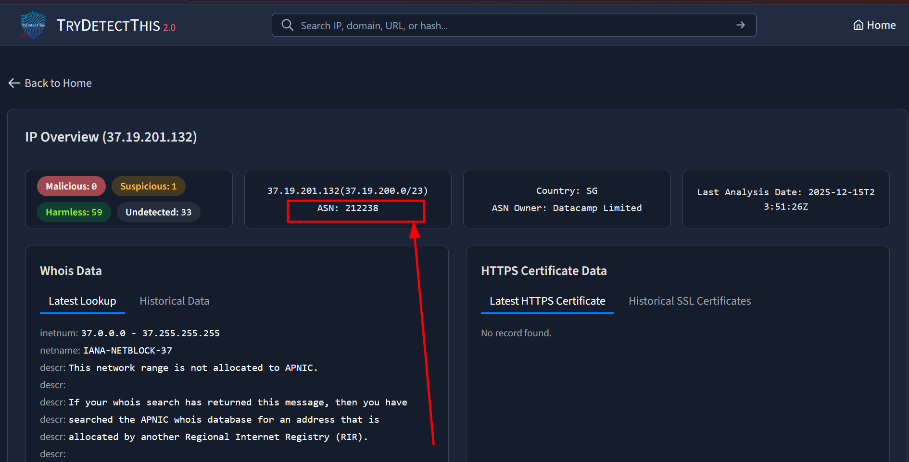
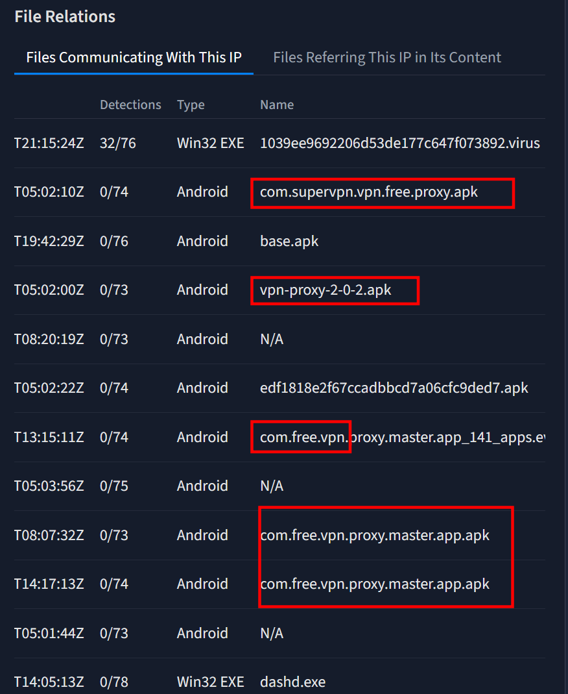
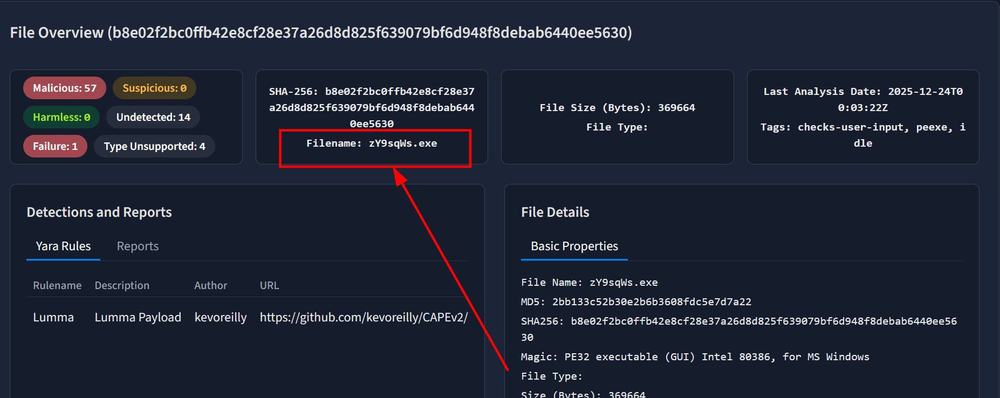
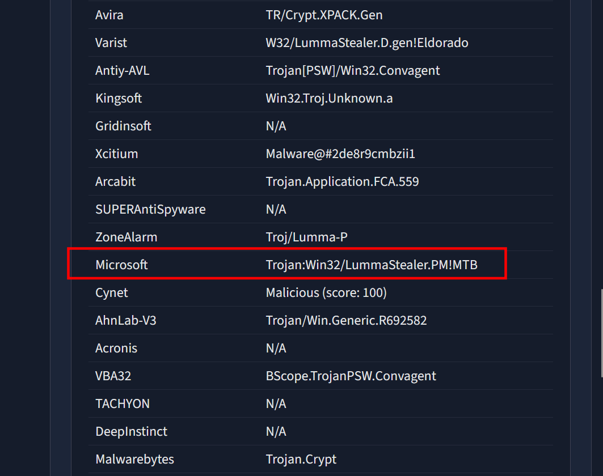
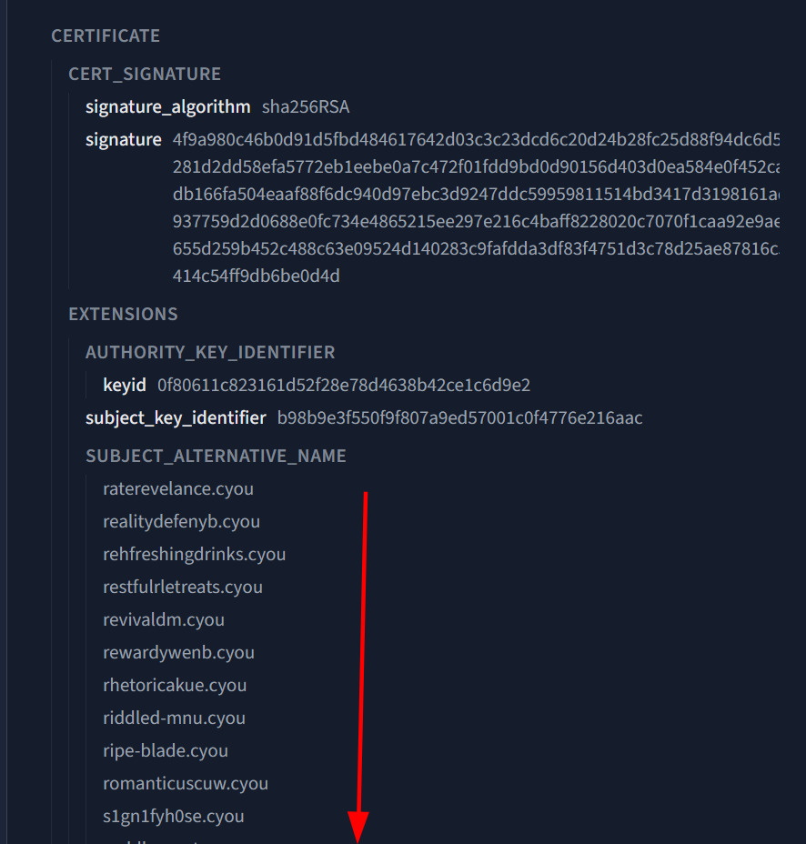
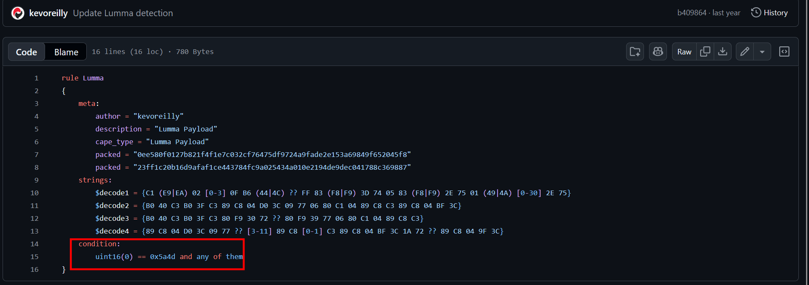
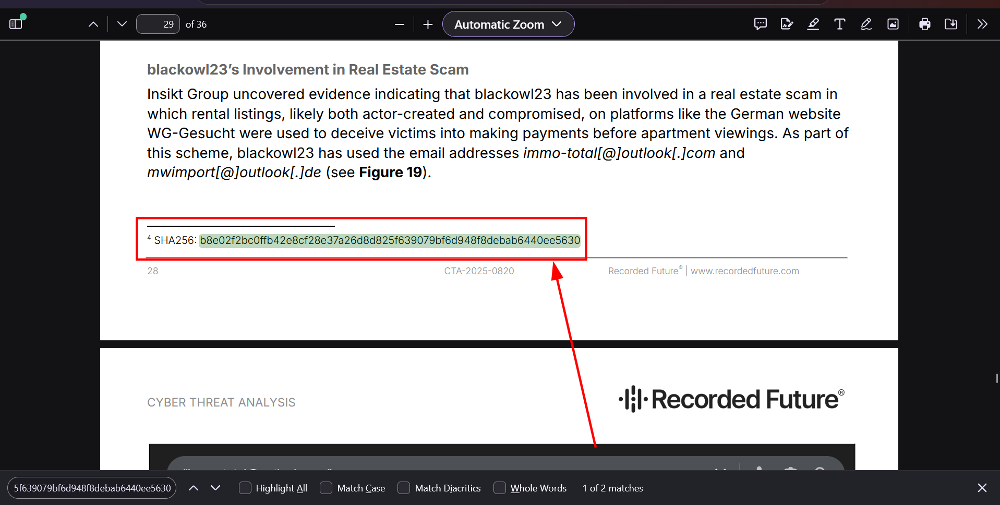
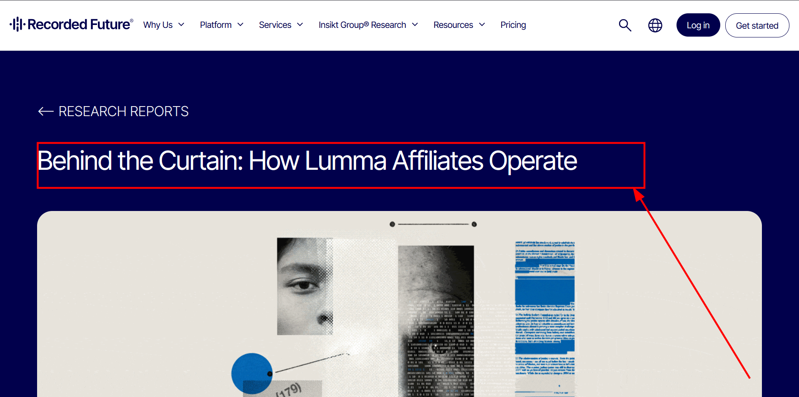

## JUST A VPN LOGIN

### Platform:

TryHackme

### Date:

13/10/2026

### Objective:

Gather threat intel to determine the risks and assist incident response.

### Scenario

- Welcome to your first shift!
  You are greeted by an internal alert on the SOC dashboard titled "Unusual VPN login of susan[.]martin@probablyfine[.]thm from 37.19.201.132 (Singapore)."

- The SOC handover notes did indeed mention that Susan from Marketing is in Singapore, attending a security vendor conference.
  It is probably just fine, but the SOC procedure tells us to verify each IP in our threat intel platform TryDetectThis.

- That login IP looks suspicious, doesn't it? Your teammates reached out to Susan, and she confirmed she did not log in to the company VPN. She also mentioned that while using a public Wi-Fi hotspot at a cafe, she was suddenly prompted to install a "security check" tool, which she did. The host telemetry reveals a suspicious binary with the hash b8e02f2bc0ffb42e8cf28e37a26d8d825f639079bf6d948f8debab6440ee5630. Can you help us figure out what this binary exactly does.

### Objectives:

1.  What is the ASN number related to the IP? ASN:_212238_

// ASN is a unique id that is assigned to a giant network that belongs to a specific organization.
// By identifying the asn number we can be able to block multiple connections from that organization without having to know their specific ips from this company called "Datacamp Limited " in Singapore:

2.  Which service is offered from this IP? _VPN_

From "file relations" we can identify services related to vpn hence our ip is offering vpn services

3.  What is the filename of the file related to the hash? _zY9sqWs.exe_

// our file hash is "b8e02f2bc0ffb42e8cf28e37a26d8d825f639079bf6d948f8debab6440ee5630"

The file is related to Lumma Stealer which is developed by a threat actor called "Shamel | HellsCoder" and is offered as Malware as a Service.

4.  What is the threat signature that Microsoft assigned to the file? _Trojan:Win32/LummaStealer.PM!MTB_

Breakdown:

- Trojan : threat type - it will disguise itself as a legitimate program to trick users into running it
- Win32 : targets 32 or 64-bit windows environment
- Lumma stealer is the malware family
- .PM : variant identifier - shows the revision of this malware
- !MTB : (microsoft threat behavioural ) - means it was caught using ml models

5.  One of the contacted domains is part of a large malicious infrastructure cluster.Based on its HTTPS certificate, how many domains are linked to the same campaign? _151_

// for the suspicious identified domains "gadgethgfub.icu - 4395
hardswarehub.today - 960
joyfulhezart.tech - 955" pivot and lookup ther https certificate.

6.  The file matches one of the YARA rules made by "kevoreilly".What line is present in the rule's "condition" field?

link: 

7.  The file is also mentioned in a threat intel report.What is the title of the report mentioning this hash? _Behind the Curtain: How Lumma Affiliates Operate_

