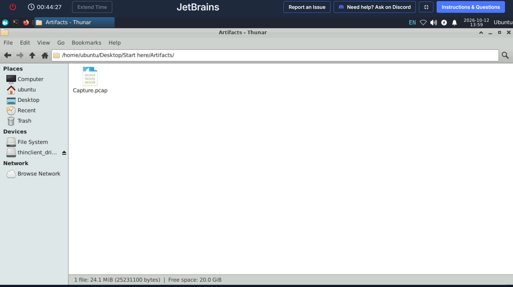
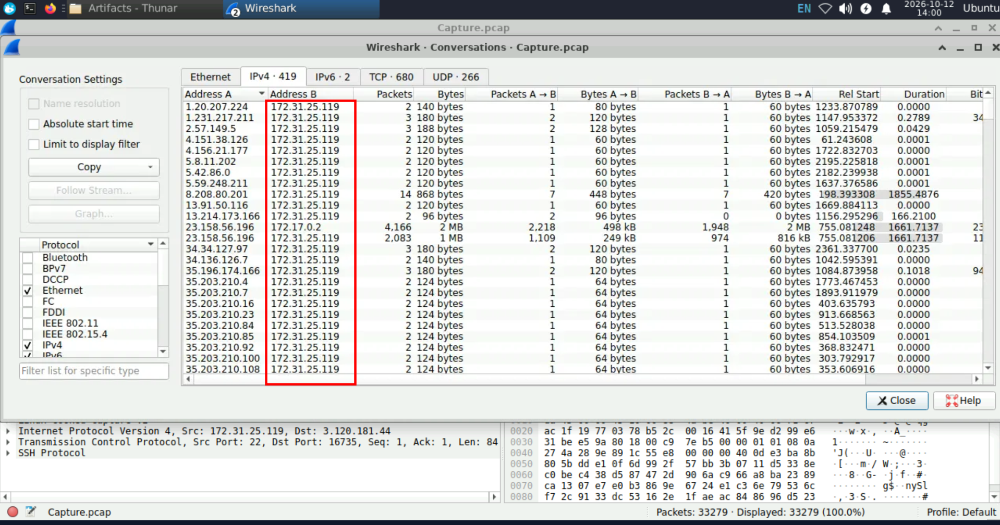

# JetBrains Lab

## Date:

12/Oct/2026

## Objective

- Analyze network traffic using Wireshark to identify web server exploitation, extract attacker IOCs and persistence mechanisms, and map attack techniques to MITRE ATT&CK.

### Category:

- Network forensics

### Tactics

- Initial access , Execution , Command and Control

### Tools

- Wireshark
- Networkminer
- Brim

#### scenario

During a recent security incident, an attacker successfully exploited a vulnerability in our web server, allowing them to upload webshells and gain full control over the system. The attacker utilized the compromised web server as a launch point for further malicious activities, including data manipulation.

As part of the investigation, You are provided with a packet capture (PCAP) of the network traffic during the attack to piece together the attack timeline and identify the methods used by the attacker. The goal is to determine the initial entry point, the attacker's tools and techniques, and the compromise's extent.

### Objectives

1. Identifying the attacker's IP address helps trace the source and stop further attacks. What is the attacker's IP address?

Accessing the pcap file:

The first objective is to identify which ips are involved in conversations and we do so by navigating to the "Conversations" tab and find an internal ip "172.31.25.119" is communicating alot:

Since it was a web attack we narrow down out investigation with the filter "ip.addr == 172.31.25.119 and ip.addr == 23.158.56.196 and http  " and identify a conversation between "172.31.25.119" and "23.158.56.196" and it seems to have brute-force patterns in login:
